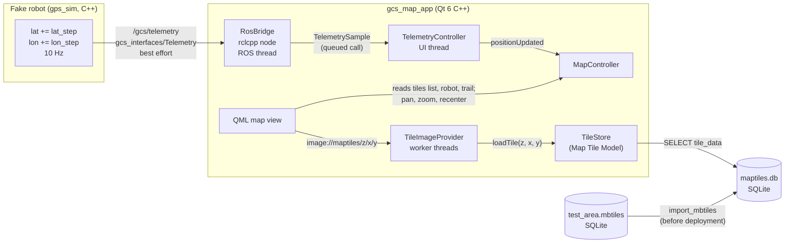

# GCS map POC: live robot position on offline map tiles

A proof of concept for the **Navigation** feature of the GCS (HLD Section 5.5). A ROS 2 node publishes the robot's GPS position on `/gcs/telemetry`. A Qt 6 C++ app subscribes with its own ROS 2 Jazzy node and shows the position live on a map. The map is drawn from **offline tiles stored in SQLite**, with no internet at any point.

For build and run steps, see **[HOW_TO_RUN.md](HOW_TO_RUN.md)**.

---

## 1. What it shows

| Question | Answer from the POC |
|---|---|
| Can a Qt C++ app receive ROS 2 Jazzy topics without freezing the UI? | Yes. The app owns an `rclcpp` node spinning on its own thread, and every message is handed to the UI thread with a queued Qt call. |
| Can the map run fully offline? | Yes. Tiles come from a local SQLite file, and nothing is downloaded at runtime. |
| Does it involve a SQLite database? | **Yes.** Offline tiles are stored in SQLite: an `.mbtiles` pack is a SQLite file, and it is imported into `maptiles.db`, the GCS map tile database from the HLD (Section 4.2.3). The app reads tiles from it with Qt SQL (`QSQLITE`). Telemetry, the position and the trail are not stored; they stay in memory, as in the HLD. |
| Can the map be drawn without Qt Location? | Yes. A small QML map draws the tiles through a C++ image provider. The view never touches storage, which keeps the HLD's MVC rules (R1, R4). |
| Is the projection right? | The test tiles have a latitude/longitude grid drawn with the same Web Mercator maths, so you can check the marker against the grid labels. |

---

## 2. The pieces

```
gcs_map_poc/                       a colcon workspace
├── src/
│   ├── gcs_interfaces/            ROS 2 message package
│   │   └── msg/Telemetry.msg      /gcs/telemetry message (POC subset of the HLD message)
│   ├── gps_sim/                   fake robot: C++ ROS 2 node (rclcpp), publishes the moving position
│   │   └── src/gps_sim_node.cpp
│   ├── gcs_tile_tools/            C++ (Qt) command-line tools for offline tiles
│   │   ├── src/make_test_mbtiles.cpp   draws a synthetic tile pack (.mbtiles) for any place
│   │   ├── src/import_mbtiles.cpp      imports an .mbtiles pack into maptiles.db (HLD schema)
│   │   └── src/TileMath.h              Web Mercator maths (same as the app)
│   └── gcs_map_app/               the GCS map app: Qt 6 C++ / QML + rclcpp
│       ├── CMakeLists.txt         ament_cmake + Qt 6 (Quick, Sql)
│       ├── src/
│       │   ├── main.cpp               wiring: ROS init, models, controllers, QML engine
│       │   ├── RosBridge.*            rclcpp node, subscription, executor thread
│       │   ├── TelemetrySample.h      plain C++ copy of one message (no ROS types in Qt code)
│       │   ├── TelemetryController.*  latest values, rate, age, lost messages -> QML
│       │   ├── MapController.*        view (centre/zoom), visible tiles, robot, trail, follow
│       │   ├── TileStore.*            Map Tile Model: reads tiles from SQLite (maptiles.db or .mbtiles)
│       │   ├── TileImageProvider.*    image://maptiles/z/x/y -> tile image, on worker threads
│       │   └── GeoMath.h              Web Mercator maths
│       └── qml/
│           ├── Main.qml           window: top bar, map, side panel
│           ├── MapView.qml        tiles, trail, robot marker, pan/zoom, overlays
│           ├── RobotMarker.qml    arrow turned to the heading
│           ├── MapButton.qml, InfoRow.qml
├── maps/                          generated tile files (not committed)
├── HOW_TO_RUN.md
└── README.md
```



---

## 3. The message: `gcs_interfaces/msg/Telemetry`

```
std_msgs/Header header
string robot_id
string interface_version
uint32 seq
sensor_msgs/NavSatFix gps      # latitude, longitude, altitude, fix status, covariance
float32 heading_deg            # clockwise from true north, NaN if unknown
```

This is the part of the HLD telemetry message (Table 5.3-5) that the map needs. The GPS position uses the standard `sensor_msgs/NavSatFix`, so a real GPS driver's output can be copied in unchanged. Joints, the IMU and the battery can be added to the same message later, without changing anything in the map.

**QoS:** best effort, keep last 1 (`rclcpp::SensorDataQoS`) on both sides. Only the newest position matters, and a lost sample is better than a late one on a radio link. A best-effort subscriber also accepts a reliable publisher, so a real `rf_node` publishing reliably would still work.

---

## 4. The fake robot (`gps_sim`)

A C++ `rclcpp` node (`src/gps_sim/src/gps_sim_node.cpp`) that stands in for the robot's `rf_node`. A wall timer fires every `1 / rate_hz` seconds, and each time it:

1. Moves the position. In the `line` pattern (default), it adds `lat_step` and `lon_step` to latitude and longitude, as asked. In the `square` pattern, it walks a square of equal ground-length sides.
2. Works out the heading from the step: `atan2(east metres, north metres)`, in degrees clockwise from north.
3. Publishes a `Telemetry` message containing:
   - `robot_id` and an increasing `seq`;
   - a `NavSatFix` with fix status `STATUS_FIX`, the altitude, and a 1 m horizontal and 2 m vertical standard deviation in the covariance;
   - the heading.

After `max_steps` steps it jumps back to the start, so a long run stays inside the tile pack. `drop_fix_every` sends occasional "no fix" messages to test how the GCS handles them. All values are ROS parameters (see HOW_TO_RUN.md).

---

## 5. The GCS map app (`gcs_map_app`)

The app follows the HLD's MVC split:

| Layer | Classes | Job |
|---|---|---|
| View (QML) | `Main.qml`, `MapView.qml`, `RobotMarker.qml` | Show what the controllers expose; send drags, zooms and taps to them. No ROS, SQL or maths in QML. |
| Controller (C++) | `RosBridge`, `TelemetryController`, `MapController` | Receive telemetry, decide what the map shows, follow the robot. |
| Model (C++) | `TileStore` (Map Tile Model), plus the robot position and trail kept in `MapController` (in memory, like the HLD's Robot State Model) | Read tiles from SQLite; hold the latest position and the trail. |

### 5.1 Receiving telemetry without blocking the UI (`RosBridge`)

- `main()` calls `rclcpp::init()` first. ROS arguments (`--ros-args …`) are removed before the app reads its own options (`--tiles`, `--zoom`).
- `RosBridge` creates the node `gcs_map_app`. It reads the parameter `telemetry_topic` (default `/gcs/telemetry`) and subscribes with `SensorDataQoS`.
- A `SingleThreadedExecutor` spins on a separate `std::thread`, so ROS callbacks never run on the Qt UI thread.
- In the callback (ROS thread), the message is copied into a plain `TelemetrySample` struct, together with the GCS arrival time. It is posted to the UI thread with `QMetaObject::invokeMethod(…, Qt::QueuedConnection)`. QML never sees a ROS type.
- On exit, the executor is cancelled and the thread joined before `rclcpp::shutdown()`. Ctrl+C in the terminal shuts ROS down, and the app then closes too.
- The project is compiled with `QT_NO_KEYWORDS` (it uses `Q_SIGNALS` / `Q_EMIT`), so Qt's `signals`/`emit` macros cannot clash with other headers.

### 5.2 Telemetry state (`TelemetryController`)

Runs on the UI thread. For each sample it:

- Keeps the latest values for the side panel: robot ID, sequence number, latitude, longitude, altitude, accuracy, heading and last update time.
- Counts lost messages from gaps in `seq`.
- Decides whether the position is usable. It needs a fix (`status >= STATUS_FIX`), finite numbers, valid ranges, and not exactly 0,0, because some drivers send zeros before the first fix.
- Measures the message rate (messages in the last second) and the age of the last message. A 200 ms timer refreshes them, so **Live** turns into **Stale** even when no messages arrive (Live means the newest message is at most 1 s old).
- Emits `positionUpdated(lat, lon, heading, headingValid, hasFix)` to the `MapController`.

### 5.3 What the map shows (`MapController` and `GeoMath.h`)

**Projection.** Tiles use Web Mercator (EPSG:3857), like almost all web and offline maps. At zoom `z` the world is `256 × 2^z` pixels square ("world pixels"):

```
x = (lon + 180) / 360 × 256 × 2^z
y = (1 − ln(tan φ + 1/cos φ) / π) / 2 × 256 × 2^z        φ = latitude in radians
```

Tile `(z, x, y)` covers world pixels `x·256 … x·256+255` and `y·256 … y·256+255`, with `y` counted from the north (the "XYZ" scheme).

**View state.** The controller keeps the view centre in world pixels and an integer zoom. Panning moves the centre. Zooming by one level doubles or halves world-pixel coordinates; `zoomAt()` keeps the point under the mouse fixed. The view is clamped to the world, and longitude wraps.

**Visible tiles.** The controller lists the tiles that cover the view, plus one extra tile on each side, so a short drag never shows an empty edge. Each tile becomes `{url: "image://maptiles/z/x/y", x, y}`.

**Small coordinates, one moving layer.** At zoom 18 the world is 67 million pixels wide. That is more than a `float` can place exactly, and the Qt scene graph uses floats. So everything is given to QML **relative to an origin**: the top-left corner of the top-left tile in the list. QML puts the tiles, the trail and the robot inside one `layer` item and moves only that layer (`layerX`, `layerY`). As a result:

- Dragging changes two numbers. Tiles are not recreated.
- The tile list is rebuilt only when a new row or column of tiles comes into view, or the zoom changes.

**Robot and trail (memory only).**

- Each fix updates the robot position.
- A trail point is added after the robot has moved at least 1 m. The trail keeps at most 5,000 points; the oldest are dropped.
- Positions are stored as latitude/longitude and converted to layer coordinates whenever the zoom or the origin changes.
- With no fix, the robot stays at its last good position and the marker turns grey.
- The trail is never written to disk (HLD 5.5: "The trail is not stored").

**Follow mode.** On by default: every new position re-centres the view on the robot. Dragging turns it off, and the ◎ button turns it back on. While following, zoom keeps the robot in the centre.

**Scale bar.** It uses the ground distance per pixel at the centre latitude, `2π × 6378137 × cos φ / (256 × 2^z)`. The bar shows the longest round distance (1, 2, 5, 10, 20 … m or km) that fits in 120 px.

### 5.4 Offline tiles in SQLite (`TileStore`)

`TileStore` is the Map Tile Model. It accepts two kinds of SQLite file and works out which kind it has from its tables:

| File | Tables | Row order | Used for |
|---|---|---|---|
| `maptiles.db`: the GCS tile database (HLD 4.2.3) | `tile_set`, `tile`, `set_tile` | XYZ (row 0 at the north) | The normal case. Several packs can be imported, a tile shared by two packs is stored once, and one pack is the default. |
| `*.mbtiles`: an MBTiles 1.3 pack | `metadata`, `tiles` | TMS (row 0 at the south): `row = 2^z − 1 − y` | Quick tests: open a pack without importing it. |

How a tile is read:

1. QML asks for `image://maptiles/18/187308/109312`.
2. `TileImageProvider` (a `QQuickAsyncImageProvider`) starts a job on its own 4-thread pool, so the UI thread never waits for the disk.
3. `TileStore::loadTile()` runs on that worker thread:
   - It uses that thread's own read-only SQLite connection. Qt SQL connections must stay on the thread that opened them, so each thread opens one the first time it needs it.
   - It runs one indexed query. For `maptiles.db`:
     ```sql
     SELECT t.tile_data FROM tile t JOIN set_tile s ON s.tile_id = t.tile_id
     WHERE s.set_id = :default_set AND t.zoom = :z AND t.x = :x AND t.y = :y
     ```
   - It decodes the PNG or JPEG into a `QImage`.
4. If the tile is missing, it tries **overzoom**: it finds the nearest lower-zoom tile that covers the area (up to 6 levels up), crops the right part and enlarges it, so zooming past the pack's deepest level shows a blurrier map instead of holes.
5. If nothing covers the area, it returns a grey "No map tiles here" tile.
6. The QML pixmap cache keeps recently shown tiles in memory, so panning back and forth does not hit the database again.

**`maptiles.db` schema** (created by `import_mbtiles`; matches HLD Tables 4.2-8 to 4.2-10):

```sql
tile_set (set_id PK, name UNIQUE, source, attribution, north, south, east, west,
          min_zoom, max_zoom, tile_count, size_bytes, is_default, imported_by, imported_at)
tile     (tile_id PK, source, zoom, x, y, format, tile_data BLOB, size_bytes, added_at,
          UNIQUE (source, zoom, x, y))          -- plus INDEX (zoom, x, y)
set_tile (set_id FK -> tile_set, tile_id FK -> tile, PRIMARY KEY (set_id, tile_id))
```

`import_mbtiles` (C++, Qt SQL) follows HLD Figure 5.5-1:

- It checks the pack: the `tiles` table, the format (PNG or JPEG), the metadata and the zoom levels.
- It copies all tiles in **one transaction**, converting TMS rows to XYZ. A tile that is already stored (same source, z, x, y) is linked rather than copied again.
- It adds the `tile_set` row and its `set_tile` links.
- If anything fails, it rolls back.
- `--remove` deletes a set's links, then every tile no longer used by any set.

### 5.5 The test tiles (`make_test_mbtiles`)

Real map data needs a licensed source and some preparation, so the POC ships a generator. It is a small Qt C++ program: it draws each tile with `QPainter` on a `QImage`, saves it as PNG, and writes it into a new MBTiles file with Qt SQL. It runs with Qt's `offscreen` platform, so it needs no display. It draws tiles from scratch, for any place, in seconds, with no internet:

- A **latitude/longitude grid** with labels. The spacing adapts to the zoom, so lines are about 100 to 250 px apart.
- **Distance rings** at 100 m, 250 m, 500 m, 1 km and 2 km around the start point, and a **START** dot.
- Each tile's **z/x/y** address, and a light checkerboard, so tile edges are visible while panning.

The grid is drawn with the same formulas as `GeoMath.h` (`TileMath.h` is a copy). If the projection or the TMS/XYZ row flip were wrong, the robot (driven by the simulator from the same start point) would not sit on START at the beginning, and its latitude/longitude would not match the grid under it. This makes the test tiles a quick end-to-end check.

---

## 6. Using real map tiles

Any **raster** MBTiles pack (PNG or JPEG, 256 px, Web Mercator) works:

```bash
ros2 run gcs_tile_tools import_mbtiles my_area.mbtiles maps/maptiles.db --default
```

Ways to get one (from HLD Section 5.5, Table 5.5-2):

| Source | How |
|---|---|
| OpenStreetMap data, rendered yourself | Download the area's OSM data, for example a `.osm.pbf` extract from Geofabrik. Style it in **QGIS**, then use *Processing → Raster tools → Generate XYZ tiles (MBTiles)* with zoom 12 to 18. The map must show "© OpenStreetMap contributors". |
| Your own imagery (drone survey, site plan) | Georeference it in QGIS, then export with the same tool, or with `gdal_translate -of MBTILES` plus `gdaladdo`. |
| A licensed offline map provider | Download or buy the area as raster MBTiles. Check that the licence allows offline use on a field device. |

Do **not** bulk-download tiles from the public `tile.openstreetmap.org` servers to make an offline pack: their tile usage policy forbids it.

Size guide: 2 km × 2 km at zoom 10 to 19 is about 25 MB. Zoom 19 alone holds three quarters of the tiles, so dropping it is the easiest way to shrink a pack.

---

## 7. How this maps to the HLD

| HLD | In the POC |
|---|---|
| `/gcs/telemetry`, best effort, `gps` (NavSatFix) and `heading_deg` fields (5.3.5, 5.5.5) | `gcs_interfaces/msg/Telemetry` (subset), `SensorDataQoS` |
| Telemetry Controller passes GPS to the Navigation Controller (5.3.3) | `TelemetryController::positionUpdated` → `MapController::onPosition` |
| Navigation Controller: fix check, trail sampling, visible tiles, follow mode (5.5.3) | `MapController` |
| Map Tile Model reads `maptiles.db`, with overzoom and a grey "no tiles" fallback (5.5.3, Figure 5.5-2) | `TileStore::loadTile` |
| Image provider `image://maptiles/z/x/y` on worker threads (5.5.3) | `TileImageProvider` (`QQuickAsyncImageProvider`) |
| Custom QML map instead of Qt Location (5.5 design decision) | `MapView.qml` |
| Import tile pack: validate, one transaction, link shared tiles (Figure 5.5-1) | `gcs_tile_tools/import_mbtiles` |
| Telemetry, position and trail not stored (5.3.6, 5.5.6) | Memory only |
| ROS on its own thread; the UI thread never blocks (rule R5) | `RosBridge` executor thread, queued calls |

---

## 8. Not in this POC (next steps)

- Heading-up map rotation (the HLD's Map panel). The POC is north-up only; the arrow turns instead.
- The Mission page, the measure tool, the layers menu, and the GPS accuracy circle.
- Robot ID checks against a robot profile, and the link state.
- The trail thinning described in the HLD. The POC drops the oldest points instead.
- Import from the GCS UI (Settings > Map). The POC imports with a command-line tool.
- `imported_by` is left empty (there are no users in the POC).
- Fractional zoom and pinch-to-zoom. Zoom is in whole levels.
- Vector tiles. The POC handles raster only.
